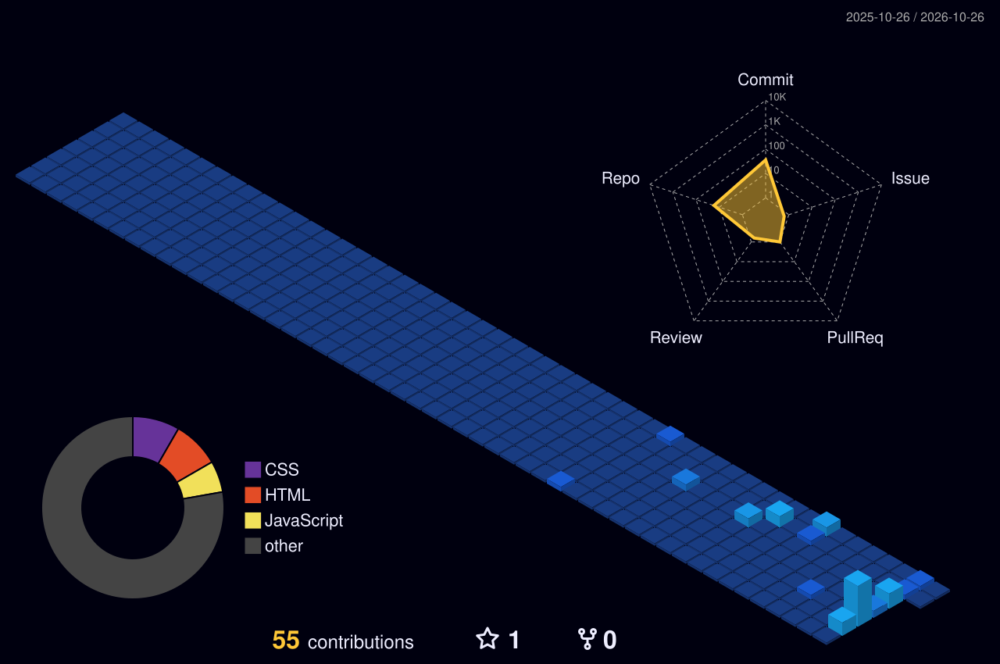

 <!-- 1. Hero Banner -->
  

    

  <!-- 2. About & Hobbies -->
  

    

  <!-- 3. Tech Stack & ID Dashboard -->
  <table border="0" cellpadding="0" cellspacing="0" width="100%">
    <tr>
      <td width="50%">
        
      </td>
      <td width="50%">
        
      </td>
    </tr>
  </table>

    

  <!-- 4. 3D Commit Skyline -->
  <h3>🏙️ My 3D Commit Skyline</h3>
  

    

  <!-- 5. Connect Footer -->
  

